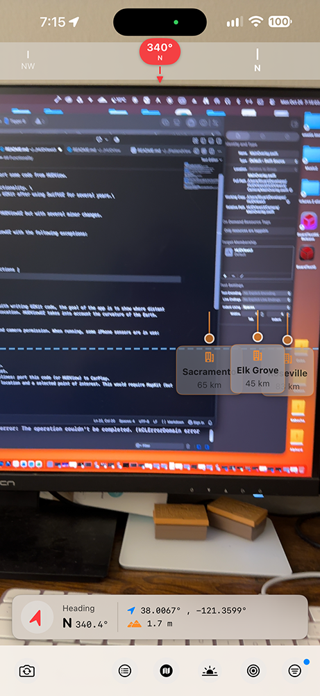
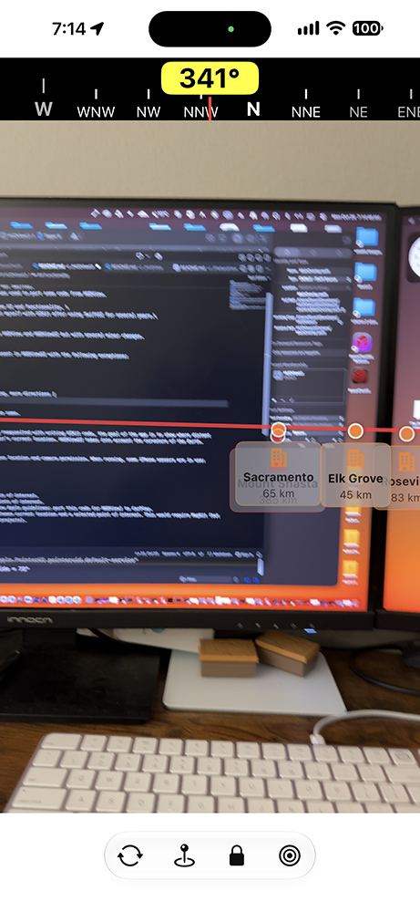

#  HUDViewUI
October 2026
Stuart Rankin
HUDViewUI is a clone of HUDView. The main differences are:
1. HUDViewUI was implemented with UIKit, not SwiftUI.
2. AI was not used to generate code but was used to port some code from HUDView.

There are several minor differences in the UI and functionality. \
The purposes of HUDViewUI was to requaint myself with UIKit after using SwiftUI for several years.\

## UI Layout
The layout is generally the same between HUDView and HUDViewUI but with several minor changes.

## Functionality
The main functionality of HUDView is present in HUDViewUI with the following exceptions:

|Feature|HUDView|HUDViewUI|
| :--- | :--- | :--- |
| POIs | Can create | Hard-coded |
| Horizon | Locked | Flexible |
| Compass | Small Heading | Large Heading, more directions |
| User Interface | Smaller elements | Larger elements |
| UI Efficiency | Larger live view | Smaller live view |
|  |  | Comparison between HUDView (left) and HUDViewUI (right).|

In general the base functionality is the same.

## Goal of App
Other than the stated goal of becoming reaquanited with writing UIKit code, the goal of the app is to show where distant points of interest are based on the user's current location. HUDViewUI takes into account the curvature of the Earth.

## Requirements
In order to function, the user must give location and camera permission. When running, some iPhone sensors are in use:
1. GPS for current location.
2. iPhone orientation and gravity.
3. Set of points of interest.

## Next
1. Add ability to filter visible points of interest.
2. Ability to add, edit, or remove points of interest.
3. It would be nice but does not follow Apple guidelines: port this code (or HUDView) to CarPlay.
4. Add linear and driving distance between current location and a selected point of interest. This would require MapKit (but was done in other programs for other projects).